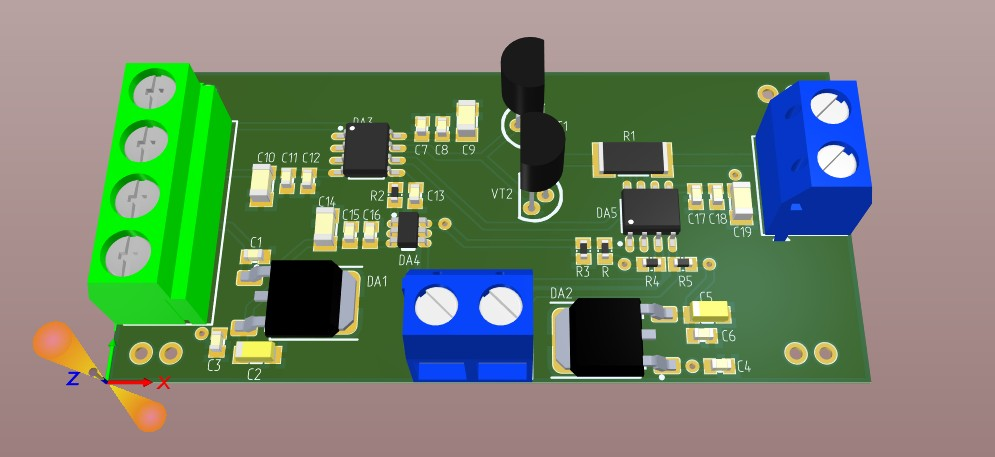

# Имитатор аналоговых датчиков напряжения, тока и сопротивления

## 1. Описание

Модуль предназначен для имитации аналоговых датчиков напряжения, тока и сопротивления.

Управление модулем осуществляется через интерфейс **USB CDC** (виртуальный последовательный порт). Выбор режима работы и установка параметров выполняются с помощью текстовых команд.

## 2. Основные характеристики

| Параметр | Значение |
|---|---|
| Тип устройства | Имитатор аналоговых датчиков |
| Режимы работы | Напряжение, ток, сопротивление |
| Диапазон установки напряжения | 0–5 В |
| Диапазон установки тока | 0–20 мА |
| Диапазон установки сопротивления | 0–100 000 Ом (100 кОм) |
| Интерфейс управления | USB CDC |
| Управляющий микроконтроллер | STM32F303CCT6 (BluePill) |
| Интерфейс связи с модулем | I²C |


## 3. Режимы работы

Модуль поддерживает три режима имитации аналоговых датчиков.

### 3.1. Имитация датчика напряжения

Позволяет задавать выходное напряжение в диапазоне **0–5 В**.

Напряжение задаётся в милливольтах (мВ). Например, значение `2500` соответствует напряжению 2,5 В.

### 3.2. Имитация датчика тока

Позволяет задавать ток в диапазоне **0–20 мА**.

Ток задаётся в миллиамперах (мА). Например, значение `12` соответствует току 12 мА.

### 3.3. Имитация датчика сопротивления

Позволяет задавать эквивалентное сопротивление в диапазоне **0–100 кОм**.

Сопротивление задаётся в омах (Ом). Например, значение `10000` соответствует сопротивлению 10 кОм.

Такой режим может использоваться для проверки измерительных каналов, предназначенных для работы с резистивными датчиками.

## 4. Интерфейс взаимодействия USB CDC

Для взаимодействия можно использовать терминальную программу или собственное приложение, поддерживающее последовательный порт.

### 4.1. Список команд

| Команда | Аргументы | Описание |
|---|---|---|
| `set_voltage` | `voltage_mV` | Установка выходного напряжения в милливольтах |
| `set_current` | `current_mA` | Установка тока в миллиамперах |
| `set_resistance` | `resistance_Ohm` | Установка сопротивления в омах |
| `get_current` | Нет | Получение значения тока |
| `set_config` | `type_config` | Выбор режима работы |
| `get_config` | Нет | Получение текущего режима работы |
| `help` | Нет | Вывод справки по доступным командам |

### 4.2. Установка выходного напряжения

**Формат команды:**

```text
set_voltage <voltage_mV>
```

Параметр `voltage_mV` задаёт напряжение в милливольтах.

Пример:

```text
set_voltage 2500
```

Устанавливает выходное напряжение 2,5 В.

Другие примеры:

```text
set_voltage 0
set_voltage 1000
set_voltage 5000
```

Соответствуют значениям 0 В, 1 В и 5 В.

### 4.3. Установка выходного тока

**Формат команды:**

```text
set_current <current_mA>
```

Параметр `current_mA` задаёт ток в миллиамперах.

Пример:

```text
set_current 12
```

Устанавливает заданный ток 12 мА.

Другие примеры:

```text
set_current 0
set_current 4
set_current 20
```

Соответствуют значениям 0 мА, 4 мА и 20 мА.

### 4.4. Установка сопротивления

**Формат команды:**

```text
set_resistance <resistance_Ohm>
```

Параметр `resistance_Ohm` задаёт сопротивление в омах.

Пример:

```text
set_resistance 10000
```

Устанавливает сопротивление 10 кОм.

Другие примеры:

```text
set_resistance 0
set_resistance 1000
set_resistance 100000
```

Соответствуют значениям 0 Ом, 1 кОм и 100 кОм.

### 4.5. Выбор режима работы

**Формат команды:**

```text
set_config <type_config>
```

Параметр `type_config` определяет активный режим имитации.

| Значение | Режим |
|---|---|
| `voltage` | Имитация датчика напряжения |
| `current` | Имитация датчика тока |
| `resistance` | Имитация датчика сопротивления |

Примеры:

```text
set_config voltage
set_config current
set_config resistance
```

После выбора режима соответствующий параметр можно установить командой `set_voltage`, `set_current` или `set_resistance`.

**Рекомендуемый порядок работы:**
1. Выбрать режим с помощью `set_config`.
2. Установить необходимое значение.
3. Проверить выбранный режим командой `get_config`.
4. При необходимости проверить измеренное значение тока командой `get_current`.

### 4.6. Получение текущей конфигурации

Команда:

```text
get_config
```

Предназначена для получения текущего режима работы модуля.

Формат ответа и перечень возвращаемых параметров определяются реализацией прошивки.

### 4.7. Получение значения тока

Команда:

```text
get_current
```

Предназначена для получения измеренного значения тока.

### 4.8. Справка по командам

Для получения справки предусмотрена команда:

```text
help
```

## 5. Аппаратная часть

Электрическая принципиальная схема устройства находится в файле:

[**UIR_imitation_VER_1_Э3.pdf**](./Hardware/UIR_imitation_VER_1_Э3.pdf)

## 6. Подключение к BluePill STM32F303CCT6

Связь между управляющей платой BluePill и модулем осуществляется через интерфейс I²C.

| Сигнал модуля | Вывод микроконтроллера | Назначение |
|---|---|---|
| `SDA` | `PB7` | Линия данных I²C |
| `SCL` | `PA15` | Линия тактирования I²C |

## 7. Общий вид модуля



*Рисунок 1 — Общий вид модуля имитации аналоговых датчиков напряжения, тока и сопротивления.*